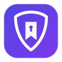

# PassMark (秘签) 🛡️

> 基于 WebDAV 的自托管端到端加密 Edge / Chrome 收藏夹与密码同步扩展 (Manifest V3)



PassMark 是一款去中心化、零知识加密的浏览器扩展，兼具 **浏览器原生收藏夹双向同步** 与 **独立加密密码保险箱** 功能。无需依赖任何中心化第三方服务器，完全由你自己的 WebDAV 网盘（如坚果云、Nextcloud、群晖 Synology、Alist 等）托管数据。

---

## ✨ 核心特性

- 🔒 **零知识端到端加密 (Zero-Knowledge)**
  - 使用浏览器原生 Web Cryptography API (`PBKDF2` 100,000 次密钥派生 + `AES-256-GCM` 认证加密）。
  - 主密码仅保留在本地内存会话中，绝不上传到云端；WebDAV 上存储的仅为高强度密文（`bookmarks.enc`、`vault.enc`）。
- 🔖 **浏览器原生收藏夹安全双向同步**
  - 读取与监听浏览器收藏夹变动，采用防抖机制（Debounce）自动同步。
  - 具备智能双向合并策略（Two-Way Merge），防覆盖、防丢失。
- 🔑 **独立密码保险箱 (Vault)**
  - 网页登录表单自动识别与悬浮一键填充（Autofill）。
  - 提交新密码时智能提示是否保存到保险箱。
  - 内置强密码生成器（支持自定义长度及字符集）。
  - 支持多域名匹配、模糊搜索、快速一键复制账号与密码。
- ☁️ **通用 WebDAV 协议**
  - 支持坚果云、Nextcloud、ownCloud、群晖 NAS、Alist 等任意标准 WebDAV 服务。
  - 支持设置后台定时自动同步频率。
- 📱 **响应式界面**
  - 界面采用响应式设计，在窄屏与平板设备上同样可用。

---

## 🚀 安装与使用指南

### 1. 开发者模式直接加载 (推荐)

1. 打开 Edge 浏览器，在地址栏输入：
   ```text
   edge://extensions/
   ```
   若使用 Chrome，则输入 `chrome://extensions/`。
2. 打开右上角的 **“开发者模式” (Developer mode)** 开关。
3. 点击左上角的 **“加载已解压的扩展程序” (Load unpacked)**。
4. 选择本项目构建后的目录：
   ```text
   .output/edge-mv3
   ```
5. 安装完成！点击浏览器右上角的扩展栏图标固定 **PassMark**。

### 2. 初始化配置 (初次使用)

1. 点击扩展图标打开弹窗，或右键选择 **“选项” (Options)** 进入配置页。
2. **配置 WebDAV 云存储**：
   - **服务器地址**：例如坚果云 `https://dav.jianguoyun.com/dav/`
   - **用户名**：你的账号
   - **密码**：服务商后台生成的**应用授权密码**
   - **子目录**：默认 `/passmark/`
   - 点击 **“测试服务器连通性”**，若显示绿色正常即可。
3. **设置主密码**：
   - 设置至少 6 位以上的主密码并牢记。
4. **一键导入浏览器历史密码 (可选)**：
   - 在 Edge 地址栏打开 `edge://settings/passwords`（Chrome 为 `chrome://password-manager/settings`）导出密码为 `.csv` 文件。
   - 在设置页第四个卡片“数据导入与迁移”中上传该文件，一键加密并同步到 WebDAV！
5. 点击 **“保存全部配置”**，即可开始全自动同步！

---

## 🛠️ 本地开发与构建

项目采用现代化扩展构建工具 [WXT](https://wxt.dev/) + Vue 3 + Tailwind CSS 构建。

```bash
# 1. 运行核心算法与加密测试套件
npm test

# 2. 启动开发模式 (支持热重载)
npm run dev

# 3. 生产环境构建（Edge）
npm run build:edge

# 4. 打包为 Edge 分发 zip
npm run zip:edge
```

> 若需构建 Chrome 版本，将 `:edge` 换成无后缀的 `npm run build` / `npm run zip`。

---

## 📁 远端 WebDAV 目录结构

PassMark 在你的 WebDAV 网盘指定的目录下维护以下文件：

```text
/passmark/
├── meta.json         # 元数据（版本号、同步时间戳、PBKDF2 随机盐）
├── bookmarks.enc     # 加密后的收藏夹树 (AES-256-GCM 密文)
└── vault.enc         # 加密后的密码保险箱数据 (AES-256-GCM 密文)
```

---

## 🛡️ 安全承诺

- **零数据收集**：插件不含任何追踪代码或第三方统计分析 SDK。
- **开源可审计**：所有网络请求仅流向用户明确配置的 WebDAV 目标地址。
- **默认不留驻密钥**：解密密钥默认仅存于浏览器会话，关闭浏览器即失效；「记住本设备」需用户主动开启。

---

## 📄 许可证与隐私

- 许可证：[MIT](LICENSE)
- 隐私政策：[PRIVACY.md](PRIVACY.md)
